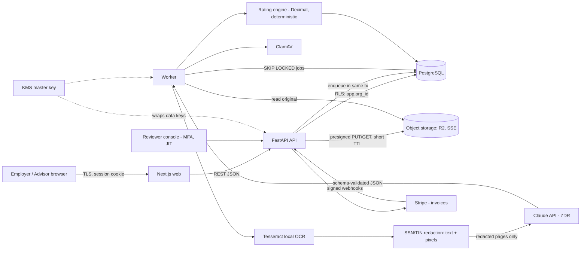
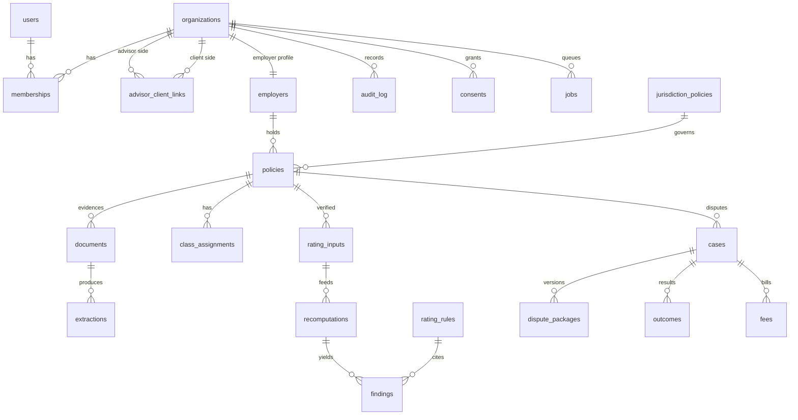

# Architecture overview

## Data flow

No path from the platform to any carrier exists in v1.

## ERD (core)

Every tenant table has `org_id NOT NULL`, RLS `FORCE`d, and an index leading with `org_id`.
